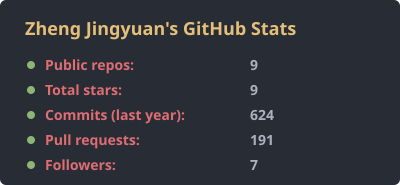
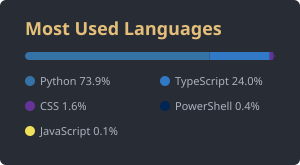

<h2 align="center">Hi, I'm Jingyuan 👋</h2>

  Chemical Engineering student at <b>Xiamen University Malaysia</b> · I build small tools for engineering and study work I'd otherwise do by hand. 
  化工专业学生，平时写些小工具，把工程和学习里重复的活自动化。

  
  
  
  
  

---

### 🔧 Projects

**[claudesidian-learning-os](https://github.com/iZHENGjy/claudesidian-learning-os)** — Claude Code + Obsidian plugins that turn lecture slides into teaching notes, an exam review vault and quizzes.
- Worked examples in the notes are re-calculated in Python, so the numbers match the lecture
- Built for and used on my own mass-transfer course
- [Live demo →](https://izhengjy.github.io/claudesidian-learning-os/)

**[chemeng-plots](https://github.com/iZHENGjy/chemeng-plots)** — graphical-method plots for separation processes: ternary diagrams, stage stepping, leaching, drying, psychrometrics.
- Each plot also returns the values it reads off the diagram
- Warns you when a construction can't finish, instead of giving a wrong stage count

**[ru-drawing-cn-annotator](https://github.com/iZHENGjy/ru-drawing-cn-annotator)** — Russian engineering drawings (PDF, DWG/DXF) → bilingual Chinese editions, without touching the original.
- Chinese is added next to the Russian as blue text (PDF) or on a separate layer (CAD)
- Numbers, ГОСТ/СП codes and material grades are kept as-is
- Started from a real translation job on a Russian construction drawing set

### 🧪 Interests

- Chemical engineering: mass transfer, separation processes, materials science
- Ionogels (literature review in progress)
- LLM agents for engineering & education: Claude Code plugins, agent skills, PDF → structured-data pipelines
- Technical translation for engineering documents (Russian → Chinese)

---

### 📊 GitHub Stats

  
  

<!-- Trophy wall: turn on once there are more stars/followers, otherwise most trophies show empty.

  

-->

### 📫 Contact

